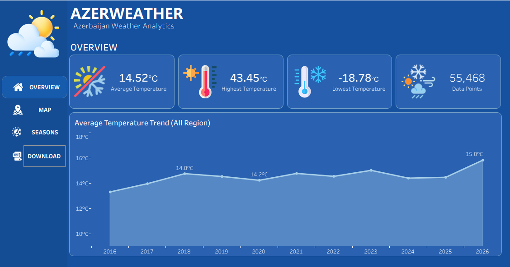
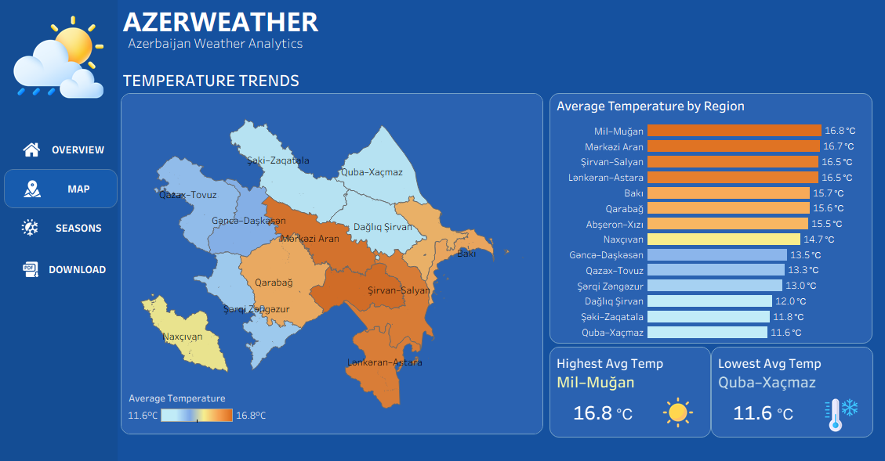
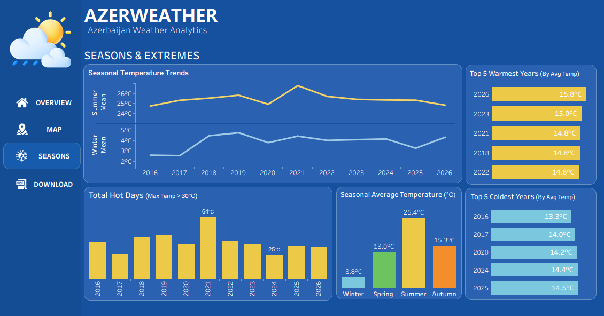

# AZERWEATHER — Azerbaijan Weather Analytics

An end-to-end data analytics project exploring historical weather patterns, temperature trends, regional differences, and extreme heat conditions across Azerbaijan's economic regions.

The project combines **Python, Open-Meteo Historical Weather API, Pandas, Tableau, and GeoJSON** to transform raw weather data into meaningful insights through interactive dashboards and data storytelling.

## Project Objectives

- Analyze historical temperature trends across Azerbaijan.
- Compare average temperatures between economic regions.
- Identify the warmest and coldest years.
- Explore summer and winter temperature patterns.
- Analyze the frequency of extreme hot days (daily maximum temperature above 30°C).
- Visualize geographical temperature differences using custom regional boundaries.

## Tools & Technologies

- **Python:** API integration, data extraction, cleaning, and validation.
- **Pandas:** Data manipulation and preprocessing.
- **Open-Meteo Historical Weather API:** Historical daily weather data.
- **Tableau:** Interactive dashboards, calculated fields, and data visualization.
- **GeoJSON:** Custom geographic boundaries for economic regions.

---

## Data Collection & Preparation

### 1. API Integration with Python

Historical daily weather data was retrieved from the Open-Meteo Historical Weather API using Python.

The API request was configured to retrieve:

- Maximum temperature (`temperature_2m_max`)
- Minimum temperature (`temperature_2m_min`)
- Mean temperature (`temperature_2m_mean`)

The request included **14 geographic coordinate pairs** representing Azerbaijan's economic regions.

To make the extraction process refreshable, the API's end date was configured dynamically:

```python
"start_date": "2016-01-01",
"end_date": date.today().isoformat()
```

The extraction process used:

- `openmeteo_requests` for API requests.
- `requests_cache` with automatic cache expiration.
- `retry_requests` to handle temporary request failures.
- `pandas` to transform API responses into structured DataFrames.

Data from all locations was combined into a single dataset while retaining `location_id`, latitude, longitude, and date for further analysis.

### 2. Data Cleaning & Validation

The extracted dataset was cleaned and validated using Pandas.

Key preprocessing steps included:

- Renaming temperature columns for consistency.
- Converting the `date` column to datetime format.
- Identifying invalid dates and duplicate records.
- Checking missing dates separately for each location.
- Validating temperature consistency:

  `temperature_min_c <= temperature_mean_c <= temperature_max_c`

- Investigating potentially suspicious temperature values.
- Exporting the cleaned dataset to CSV for Tableau.

These steps helped improve data consistency and reliability before visualization.

---

## Tableau Dashboards

The project includes three interconnected dashboards, each focusing on a different aspect of Azerbaijan's weather patterns.

### 1. Overview Dashboard



**Purpose:** Provides a high-level overview of temperature indicators and annual temperature trends.

**Visualizations & Storytelling:**

- **Average Temperature:** Presents the overall average temperature across the analyzed locations and period, establishing a baseline for the analysis.
- **Highest Temperature:** Highlights the highest recorded daily maximum temperature, showing the most extreme heat value in the dataset.
- **Lowest Temperature:** Shows the lowest recorded daily minimum temperature, providing insight into the coldest recorded conditions.
- **Data Points:** Displays the total number of observations, giving users an idea of the dataset's coverage.
- **Average Temperature Trend:** A yearly line chart showing how average temperatures have evolved over time.

**Storytelling insight:** The overview introduces the central question of the project: how have temperature patterns across the selected locations in Azerbaijan changed over the analyzed period? The annual trend provides the starting point for exploring regional and seasonal differences.

### 2. Regional Temperature Map



**Purpose:** Explores the geographical distribution of average temperatures across Azerbaijan's economic regions.

**Visualizations & Storytelling:**

- **Custom GeoJSON Map:** Displays economic-region boundaries instead of individual city points, allowing users to explore temperature distribution geographically.
- **Average Temperature by Region:** A horizontal bar chart ranking economic regions from warmest to coldest.
- **Highest Average Temperature:** Highlights the warmest economic region.
- **Lowest Average Temperature:** Identifies the coldest economic region.

**Technical implementation:**

A custom GeoJSON file was prepared using geographic boundary coordinates for the economic regions. This enabled Tableau to visualize regional polygons rather than treating each coordinate as an individual city.

Temperature-based color encoding was applied to make geographical differences easier to interpret.

**Storytelling insight:** The regional comparison reveals that temperature is not distributed equally across Azerbaijan. In the displayed results, Mil-Mugan has the highest average temperature (16.8°C), while Quba-Khachmaz has the lowest (11.6°C). This represents a 5.2°C difference between the two regions and highlights the geographical variation in temperature.

### 3. Seasons & Extremes Dashboard



**Purpose:** Investigates seasonal temperature patterns, annual extremes, and the frequency of hot days.

**Visualizations & Storytelling:**

- **Seasonal Temperature Trends:** Two separate annual line charts showing summer and winter mean temperatures, with linear trend lines. This comparison helps explore whether seasonal temperature patterns have changed differently over time.
- **Top 5 Warmest Years:** Ranks the five years with the highest annual average temperatures, identifying particularly warm years.
- **Top 5 Coldest Years:** Ranks the five years with the lowest annual average temperatures, highlighting relatively colder years.
- **Total Hot Days:** Counts days when daily maximum temperature exceeded 30°C. This metric helps examine the frequency of extreme heat conditions and how it varies between years.
- **Seasonal Average Temperature:** Compares average temperatures across winter, spring, summer, and autumn, showing the differences between seasons.

**Key Tableau Calculations:**

Several calculated fields and Level of Detail (LOD) expressions were used to create analytical metrics.

**Annual Average Temperature**

```tableau
{ FIXED YEAR([date]) :
    AVG([temperature_mean_c])
}
```

Calculates the annual average temperature for ranking the warmest and coldest years.

**Summer Temperature**

```tableau
IF DATEPART('month', [date]) IN (6, 7, 8)
THEN [temperature_mean_c]
END
```

**Winter Temperature**

```tableau
IF DATEPART('month', [date]) IN (12, 1, 2)
THEN [temperature_mean_c]
END
```

**Winter Year**

December is assigned to the following year so that December, January, and February are grouped into the same winter season.

```tableau
IF DATEPART('month', [date]) = 12 THEN
    DATEPART('year', [date]) + 1
ELSE
    DATEPART('year', [date])
END
```

**Hot Days Above 30°C**

```tableau
{ FIXED YEAR([date]), [location_id] :
    COUNTD(
        IF [temperature_max_c] > 30
        THEN [date]
        END
    )
}
```

Counts the number of days per year and location when daily maximum temperature exceeded 30°C.

Annual rankings were also created using Tableau ranking calculations to identify the warmest and coldest years.

**Storytelling insight:** Seasonal and extreme-weather analysis adds more detail to the overall temperature picture. Comparing summer and winter trends helps reveal differences in seasonal behavior, while the warmest and coldest year rankings identify notable annual variations. The hot-days chart adds another perspective by focusing on how frequently temperatures exceed the 30°C threshold.

---

## Key Findings

Based on the displayed dashboard results:

- **Mil-Mugan** recorded the highest regional average temperature (16.8°C).
- **Quba-Khachmaz** recorded the lowest regional average temperature (11.6°C).
- The difference between the warmest and coldest regional averages was **5.2°C**.
- The annual average temperature reached **15.8°C in 2026** in the current dataset.
- Seasonal analysis reveals distinct summer and winter temperature patterns.
- The project tracks the annual frequency of days with maximum temperatures above 30°C.

*Note: 2026 contains partial-year data and should not be directly compared with complete calendar years.*

## Project Outcome

AZERWEATHER demonstrates an end-to-end data analytics workflow, from retrieving historical weather data through an external API to cleaning, validating, analyzing, and visualizing it in Tableau.

The project highlights practical skills in:

- API integration and automated data extraction.
- Data cleaning and validation with Python and Pandas.
- Analytical calculations using Tableau LOD expressions and date-based logic.
- Custom geographic visualization with GeoJSON.
- Interactive dashboard development and data storytelling.

The goal is not only to visualize weather data, but also to turn it into understandable insights about regional differences, seasonal patterns, and temperature extremes across Azerbaijan.
